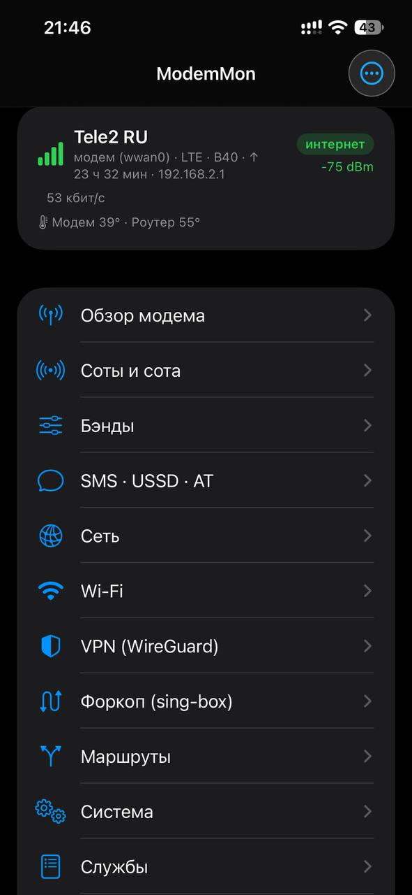
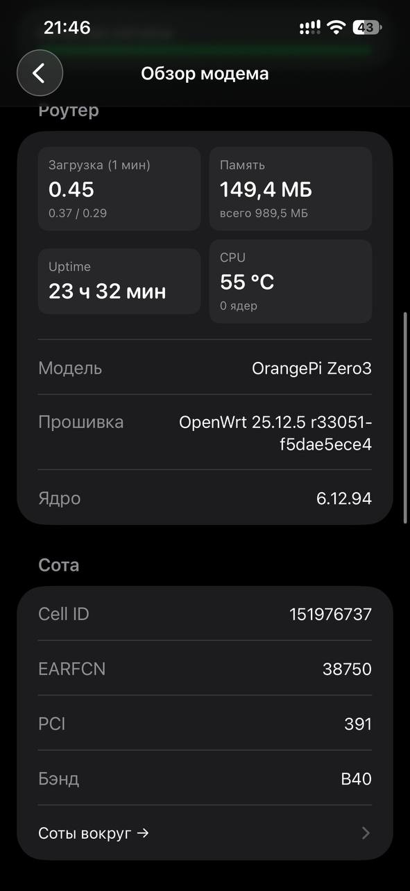
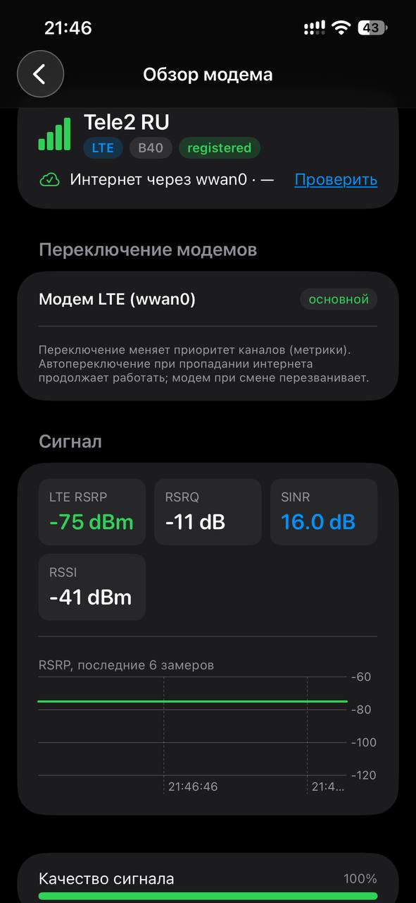

# ModemMon iOS

**English** | [Русский](README.md)

iOS app (SwiftUI) for managing an OpenWrt router with an LTE modem —
a port of the Android version [ModemMon](https://github.com/franhzyz/modemmon-android).

## Requirements

The app works only with packages from the repository
[https://github.com/Medvedolog/medvemodem](https://github.com/Medvedolog/medvemodem)
(medvemodem, luci-app-forkop, sing-box-forkop and related packages).

## Installing packages on the router

Router script: [`openwrt/install-modemmon.sh`](openwrt/install-modemmon.sh) —
it detects the architecture and OpenWrt version, downloads and installs the packages.
Run on the router via SSH:

```sh
sh install-modemmon.sh
```

Ready-made packages (aarch64_cortex-a53 / aarch64_generic / x86_64, OpenWrt 24.10 and 25.12) —
in the [Medvedolog/medvemodem releases](https://github.com/Medvedolog/medvemodem/releases)
and attached to this repository's releases.

## Languages / Языки

The app is bilingual: Russian and English. Switcher — Settings → «Язык / Language».

## Screenshots

| Menu | Modem overview | Modem switching |
|---|---|---|
|  |  |  |

## Features

- Modem overview: signal, antennas, bearer, traffic, telemetry (schema v2)
- Cells/bands, SMS · USSD · AT commands
- Network: interfaces, Wi-Fi, routes, DHCP
- **Modem switching** (primary ↔ backup) via uci metrics
- Forkop: status, dashboard, section test, diagnostics, section and link editor
- Speed test (Yandex Internetometer) from the router on a selected channel
- VPN (WireGuard/AmneziaWG), Services, UCI config, Terminal, Files, Wake-on-LAN, Diagnostics

## Installing on iPhone (Sideloadly)

The build is unsigned — sign it with **your own Apple ID** (the author's account is not needed).
You will need: a PC with Windows/macOS, a cable, an iPhone, an Apple ID.

1. Download and install [Sideloadly](https://sideloadly.io).
2. Download the ipa from the [releases](https://github.com/franhzyz/modemmon-ios/releases).
3. Connect the iPhone by cable, open Sideloadly.
4. Drag the ipa into the window, enter your Apple ID in the Apple ID field.
5. Press Start — in a minute the app will appear on the iPhone.
6. On the iPhone: Settings → General → VPN & Device Management → trust your Apple ID (if asked).

**Free Apple ID limits:** the signature lasts 7 days — afterwards just repeat steps 3-5.
Alternatives: [AltStore](https://altstore.io) (re-signs automatically over Wi-Fi), TrollStore (forever, only iOS up to 16.6.1).
Installation without a PC is impossible (a signature is required).

## Building

Unsigned builds via [Codemagic](https://codemagic.io); installing on iPhone —
via [Sideloadly](https://sideloadly.io).
