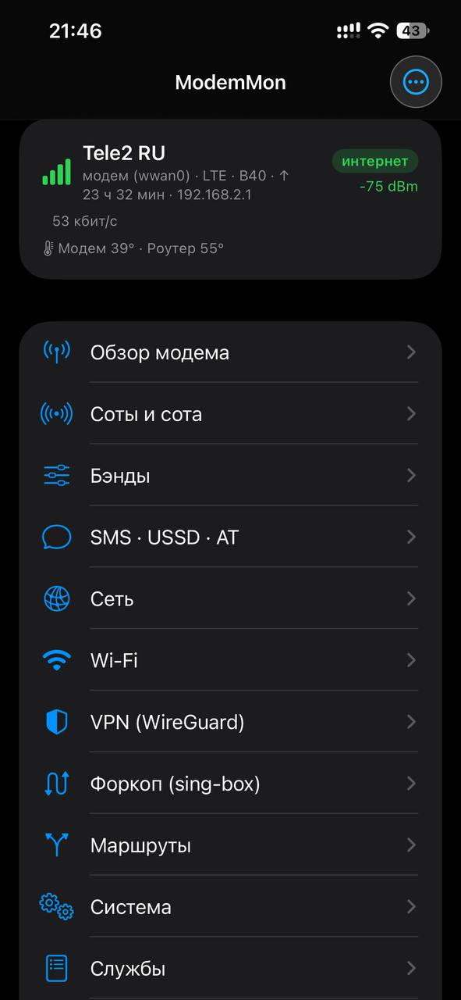
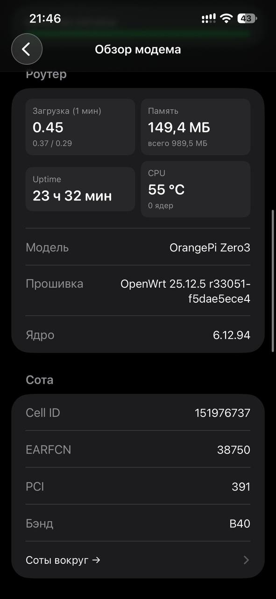
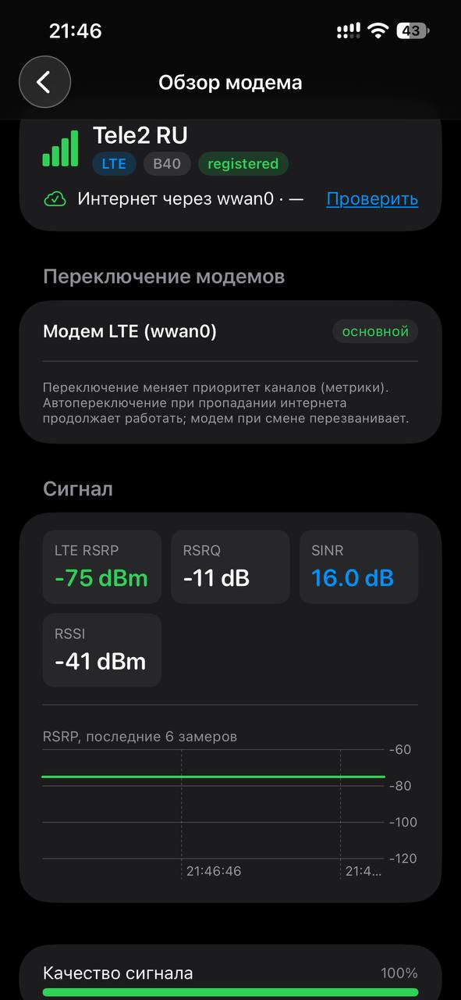

# ModemMon iOS

iOS-приложение (SwiftUI) для управления OpenWrt-роутером с LTE-модемом —
порт Android-версии [ModemMon](https://github.com/franhzyz/modemmon-android).

## Требования

Приложение работает только с пакетами из репозитория
[https://github.com/Medvedolog/medvemodem](https://github.com/Medvedolog/medvemodem)
(medvemodem, luci-app-forkop, sing-box-forkop и связанные пакеты).

## Скриншоты

| Меню | Обзор модема | Переключение модемов |
|---|---|---|
|  |  |  |

## Возможности

- Обзор модема: сигнал, антенны, bearer, трафик, телеметрия (schema v2)
- Соты/бэнды, SMS · USSD · AT-команды
- Сеть: интерфейсы, Wi-Fi, маршруты, DHCP
- **Переключение модемов** (основной ↔ резервный) через uci-метрики
- Форкоп: статус, дашборд, тест секций, диагностика, редактор секций и ссылок
- Спидтест (Яндекс.Интернетометр) с роутера по выбранному каналу
- VPN (WireGuard/AmneziaWG), Службы, Конфиг UCI, Терминал, Файлы, Wake-on-LAN, Диагностика

## Установка на iPhone (Sideloadly)

Сборка не подписана — подписываешь её **своим Apple ID** (аккаунт автора не нужен).
Понадобится: ПК с Windows/macOS, кабель, iPhone, Apple ID.

1. Скачай [Sideloadly](https://sideloadly.io) и установи.
2. Скачай ipa из [релизов](https://github.com/franhzyz/modemmon-ios/releases).
3. Подключи iPhone кабелем, открой Sideloadly.
4. Перетащи ipa в окно, в поле Apple ID введи свой Apple ID.
5. Нажми Start — через минуту приложение появится на iPhone.
6. На iPhone: Настройки → Основные → VPN и управление устройством → доверь своему Apple ID (если попросит).

**Ограничения бесплатного Apple ID:** подпись живёт 7 дней — потом просто повтори шаги 3-5.
Альтернативы: [AltStore](https://altstore.io) (сам переподписывает по Wi-Fi), TrollStore (навсегда, только iOS до 16.6.1).
Без ПК установка невозможна (нужна подпись).

## Сборка

Unsigned-сборка через [Codemagic](https://codemagic.io); установка на iPhone —
через [Sideloadly](https://sideloadly.io).
